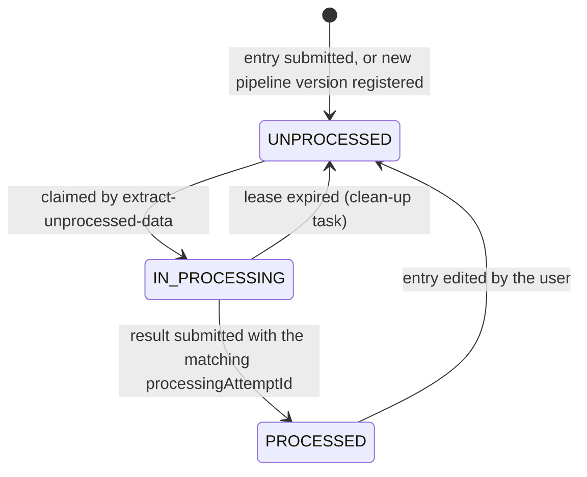

# Preprocessing queue and leases

Preprocessing pipelines fetch work from `extract-unprocessed-data` and send results back to `submit-processed-data`.
This document describes how several pipeline pods and pipeline versions can claim work and return results safely.

See also the [pipeline specification](../../preprocessing/specification.md) for the API contract seen by a pipeline.

## The queue

The queue is the `sequence_entries_preprocessed_data` table itself. It holds one row per `(accession, version, pipeline_version)`, and every row is in one of three states:



| Status          | `processing_attempt_id` | `lease_until` |
| --------------- | ----------------------- | ------------- |
| `UNPROCESSED`   | `NULL`                  | `NULL`        |
| `IN_PROCESSING` | set                     | set           |
| `PROCESSED`     | `NULL`                  | `NULL`        |

This invariant is enforced by the `sequence_entries_preprocessed_data_ownership_check` constraint.
Revocations are never queued.

### Why rows exist before they are claimed

Before the queue, a row was only created when a pipeline claimed an entry, and "unprocessed" meant "no row for this pipeline version".
That had three problems:

- A row that does not exist cannot be locked. The claim locked the `sequence_entries` row instead, with `FOR UPDATE SKIP LOCKED`. That lock is released when the claiming transaction commits. A concurrent claim whose snapshot was taken before that commit still sees the entry as unclaimed and can lock it. Duplicates were only stopped by `ON CONFLICT DO NOTHING` on insert, so the second claim got a short or empty batch.
- The `sequence_entries` row is shared by all pipeline versions, so pods of different versions skipped each other's entries.
- Every poll had to anti-join all `sequence_entries` of the organism against the processed data to find the missing rows.

With a row per job, a claim locks the job itself, and finding work is a read of the queue head through the partial index `sepd_unprocessed_claim_idx`.

## Claiming: leases

`extract-unprocessed-data` claims up to `numberOfSequenceEntries` entries in a single statement:

```sql
UPDATE sequence_entries_preprocessed_data
SET processing_status = 'IN_PROCESSING', processing_attempt_id = ?, started_processing_at = ?, lease_until = ?
FROM (SELECT ... WHERE organism = ? AND pipeline_version = ? AND processing_status = 'UNPROCESSED'
      ORDER BY accession, version LIMIT ? FOR UPDATE SKIP LOCKED) candidates
WHERE <keys match candidates>
```

- `SKIP LOCKED` lets concurrent claims each take a different slice of the queue head without waiting on each other.
- One `processingAttemptId` (a random UUID) is generated per request and shared by all entries of that batch.
- `leaseUntil` is the claim time plus `loculus.cleanup.task.reset-stale-in-processing-after-seconds`. The Helm chart sets this from `preprocessingTimeout` (600 s by default).
- The claimed rows are then streamed back, selected by `processing_attempt_id`. Each NDJSON line carries `processingAttemptId` and `leaseUntil` (Unix seconds).

A lease cannot be extended. Cleanup can reset a claim after its expiry, so `preprocessingTimeout` must comfortably exceed the time to process one batch.

## Submitting results

Every result line must carry the `processingAttemptId` it was claimed with.
Results are stored per batch in one `UPDATE ... FROM unnest(...)` that only matches rows that are:

- `IN_PROCESSING`,
- for the submitted organism and pipeline version,
- owned by the submitted `processingAttemptId`.

If any line of the request does not match, the whole request is rolled back and answered with `422`. The message says why: the entry is not awaiting results at all, not for this pipeline version, not for this organism, or the attempt no longer owns it.
A late result from an expired lease therefore cannot overwrite the result of the attempt that re-claimed the entry.

## Expired leases

`CleanUpStaleSequencesInProcessingTask` runs every `loculus.cleanup.task.run-every-seconds` (60 s by default).
It returns every `IN_PROCESSING` row whose `lease_until` has passed to `UNPROCESSED`, and clears the attempt id, lease, timestamps and any partial results.
An entry is therefore handed out again between `leaseUntil` and `leaseUntil` plus one clean-up interval.

Before the queue, the clean-up task deleted stale rows based on `started_processing_at`. Rows are now reset instead, because the row is the queue entry.
Editing a sequence entry resets its rows the same way, so the edited data is processed again by every pipeline version.

## How rows get into the queue

`preprocessing_queue_versions` lists the `(organism, pipeline_version)` pairs that have a queue. `initialized_at` is set once that version's backfill has completed.

### New submissions and revisions

`UploadDatabaseService.enqueueForPreprocessing` inserts an `UNPROCESSED` row for each registered pipeline version of the organism.
It runs in the same transaction that inserts the sequence entries.

### A new pipeline version

The first `extract-unprocessed-data` call for an unregistered pipeline version creates its queue, in two transactions:

1. **Register** (`registerPreprocessingQueueVersion`). Read the current pipeline version for this organism `FOR SHARE`. Reject older versions, then insert the requested version with `initialized_at = NULL`.
   - The row lock coordinates registration with version retirement for this organism.
   - Submissions take the same shared lock. They can continue while a version is registered.
   - Registration does not lock `sequence_entries`.
2. **Backfill** (`backfillPreprocessingQueue`). Insert an `UNPROCESSED` row for every non-revoked entry of the organism that has none for this version, then set `initialized_at`.
   - The version row is read `FOR UPDATE SKIP LOCKED`, so only one caller runs the backfill.
   - Concurrent callers skip it and poll again later if no jobs are available.

A submission already in progress can miss both registration and backfill. The repair task queues its missing jobs after the submission commits.

Before the queue, these rows were created a batch at a time as pipelines claimed them.
Now they are all created in one `INSERT ... SELECT` when the first pod of a new version starts polling.
The total number of rows is the same, but the write load is concentrated.
For organisms with many entries, expect a spike in write-ahead log, a long-running transaction and some table bloat at that moment.
Splitting the backfill into chunks would avoid this if it becomes a problem.

### Retiring a pipeline version

When `UseNewerProcessingPipelineVersionTask` switches an organism to a newer pipeline version, it locks that organism's row in `current_processing_pipeline` `FOR UPDATE`.
It waits for submissions and registrations that hold the shared row lock, then updates the current version and deletes older versions from `preprocessing_queue_versions`.
Other organisms can continue writing to `sequence_entries`.
After retirement, submissions no longer queue entries for older versions. Their processed data is deleted by `cleanUpOutdatedPreprocessingData` as before.
A pipeline of a retired version is rejected by the version check during registration.

### Entries that missed the enqueue

`EnqueueMissingPreprocessingEntriesTask` runs at startup and then every `loculus.preprocessing-queue.enqueue-missing-every-seconds` (300 s by default).
For every version whose backfill has completed, it inserts the missing `UNPROCESSED` rows and logs a warning with the count.
It reads the version rows `FOR KEY SHARE`, so retiring a version waits for it and nothing is queued for a retired version.

This task is required during normal operation. Submissions can commit after a new version's initial backfill and need a later repair run. Some jobs therefore wait for the next successful run. The recurring search for missing jobs also adds database work.
