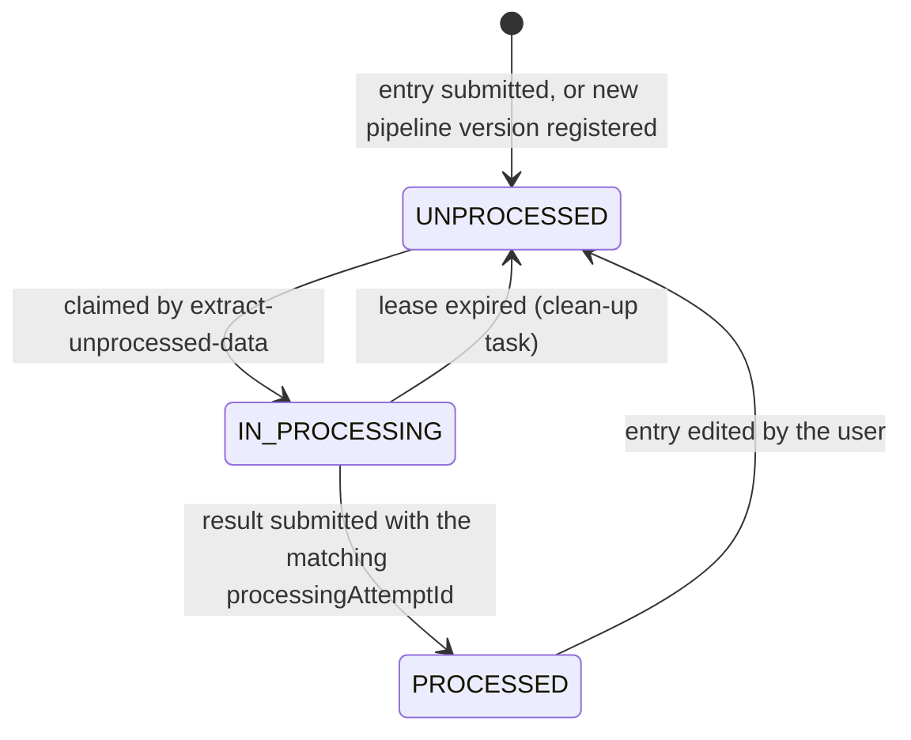

# Preprocessing queue and leases

Preprocessing pipelines fetch work from `extract-unprocessed-data` and send results back to `submit-processed-data`.
This document describes how the backend hands out work so that several pipeline pods, and several pipeline versions, can run at the same time without processing an entry twice or losing it.

See also the [pipeline specification](../../preprocessing/specification.md) for the API contract seen by a pipeline.

## The queue

The queue is the `sequence_entries_preprocessed_data` table itself. It holds one row per `(accession, version, pipeline_version)`, and every row is in one of three states:



| Status          | `processing_attempt_id` | `lease_until` |
| --------------- | ----------------------- | ------------- |
| `UNPROCESSED`   | `NULL`                  | `NULL`        |
| `IN_PROCESSING` | set                     | set           |
| `PROCESSED`     | `NULL`                  | `NULL`        |

This invariant is enforced by the `sequence_entries_preprocessed_data_ownership_check` constraint.
Revocations are never queued.

### Why rows exist before they are claimed

Before the queue, a row was only created when a pipeline claimed an entry, and "unprocessed" meant "no row for this pipeline version".
That had three problems:

- A row that does not exist cannot be locked. The claim locked the `sequence_entries` row instead, with `FOR UPDATE SKIP LOCKED`. That lock is released when the claiming transaction commits. A concurrent claim whose snapshot was taken before that commit still sees the entry as unclaimed and can lock it. Duplicates were only stopped by `ON CONFLICT DO NOTHING` on insert, so the second claim got a short or empty batch.
- The `sequence_entries` row is shared by all pipeline versions, so pods of different versions skipped each other's entries.
- Every poll had to anti-join all `sequence_entries` of the organism against the processed data to find the missing rows.

With a row per job, a claim locks the job itself, and finding work is a read of the queue head through the partial index `sepd_unprocessed_claim_idx`.

## Claiming: leases

`extract-unprocessed-data` claims up to `numberOfSequenceEntries` entries in a single statement:

```sql
UPDATE sequence_entries_preprocessed_data
SET processing_status = 'IN_PROCESSING', processing_attempt_id = ?, started_processing_at = ?, lease_until = ?
FROM (SELECT ... WHERE organism = ? AND pipeline_version = ? AND processing_status = 'UNPROCESSED'
      ORDER BY accession, version LIMIT ? FOR UPDATE SKIP LOCKED) candidates
WHERE <keys match candidates>
```

- `SKIP LOCKED` lets concurrent claims each take a different slice of the queue head without waiting on each other.
- One `processingAttemptId` (a random UUID) is generated per request and shared by all entries of that batch.
- `leaseUntil` is the claim time plus `loculus.cleanup.task.reset-stale-in-processing-after-seconds`. The Helm chart sets this from `preprocessingTimeout` (600 s by default).
- The claimed rows are then streamed back, selected by `processing_attempt_id`. Each NDJSON line carries `processingAttemptId` and `leaseUntil` (Unix seconds).

A lease cannot be extended. A pipeline that takes longer than the lease for a batch loses it, so `preprocessingTimeout` must comfortably exceed the time to process one batch.

## Submitting results

Every result line must carry the `processingAttemptId` it was claimed with.
Results are stored per batch in one `UPDATE ... FROM unnest(...)` that only matches rows that are:

- `IN_PROCESSING`,
- for the submitted organism and pipeline version,
- owned by the submitted `processingAttemptId`.

If any line of the request does not match, the whole request is rolled back and answered with `422`. The message says why: the entry is not awaiting results at all, not for this pipeline version, not for this organism, or the attempt no longer owns it.
A late result from an expired lease therefore cannot overwrite the result of the attempt that re-claimed the entry.

## Expired leases

`CleanUpStaleSequencesInProcessingTask` runs every `loculus.cleanup.task.run-every-seconds` (60 s by default).
It returns every `IN_PROCESSING` row whose `lease_until` has passed to `UNPROCESSED`, and clears the attempt id, lease, timestamps and any partial results.
An entry is therefore handed out again between `leaseUntil` and `leaseUntil` plus one clean-up interval.

Before the queue, the clean-up task deleted stale rows based on `started_processing_at`. Rows are now reset instead, because the row is the queue entry.
Editing a sequence entry resets its rows the same way, so the edited data is processed again by every pipeline version.

## How rows get into the queue

`preprocessing_queue_versions` lists the `(organism, pipeline_version)` pairs that have a queue. `initialized_at` is set once that version's backfill has completed.

### New submissions and revisions

`UploadDatabaseService.enqueueForPreprocessing` inserts an `UNPROCESSED` row for each registered pipeline version of the organism.
It runs in the same transaction that inserts the sequence entries.

### A new pipeline version

The first `extract-unprocessed-data` call for an unregistered pipeline version creates its queue, in two transactions:

1. **Register** (`registerPreprocessingQueueVersion`). This takes `LOCK TABLE sequence_entries IN SHARE ROW EXCLUSIVE MODE`, checks that the version is not older than the current one, and inserts the version with `initialized_at = NULL`.
   - The lock waits for submissions already in progress and blocks new ones until the registration commits.
   - After the commit, every entry was either inserted before (and is picked up by the backfill) or is inserted after (and is queued by its own submission, which now sees the version).
   - The lock is held only for this short transaction, but it blocks submissions for all organisms meanwhile.
2. **Backfill** (`backfillPreprocessingQueue`). This inserts an `UNPROCESSED` row for every non-revoked entry of the organism that has none for this version, then sets `initialized_at`.
   - The version row is read `FOR UPDATE SKIP LOCKED`, so only one caller runs the backfill.
   - Concurrent callers skip it, find an empty queue, and poll again later.

Before the queue, these rows were created a batch at a time as pipelines claimed them.
Now they are all created in one `INSERT ... SELECT` when the first pod of a new version starts polling.
The total number of rows is the same, but the write load is concentrated.
For organisms with many entries, expect a spike in write-ahead log, a long-running transaction and some table bloat at that moment.
Splitting the backfill into chunks would avoid this if it becomes a problem.

### Retiring a pipeline version

When `UseNewerProcessingPipelineVersionTask` switches an organism to a newer pipeline version, it deletes the older versions from `preprocessing_queue_versions` under the same `sequence_entries` lock.
After that, no submission queues entries for them. Their processed data is deleted by `cleanUpOutdatedPreprocessingData` as before.
A pipeline of a retired version is rejected by the version check during registration.

### Entries that missed the enqueue

`EnqueueMissingPreprocessingEntriesTask` runs at startup and then every `loculus.preprocessing-queue.enqueue-missing-every-seconds` (300 s by default).
For every version whose backfill has completed, it inserts the missing `UNPROCESSED` rows and logs a warning with the count.
It reads the version rows `FOR KEY SHARE`, so retiring a version waits for it and nothing is queued for a retired version.

It exists for the rolling deploy below. Once no backend from before the queue can still be running, nothing should go missing, and the task can be removed.

## Rolling out the queue onto a running instance

The queue is introduced by four migrations, which Flyway applies when the first new backend pod starts:

1. `V1.36__expand_preprocessing_work_queue` adds `organism`, `processing_attempt_id` and `lease_until`, backfills `organism` on existing rows, and adds the status check, `preprocessing_queue_versions` and the indexes. It takes no table lock, but the `organism` backfill updates every row.
2. `V1.37__activate_preprocessing_work_queue` takes `SHARE ROW EXCLUSIVE` on `sequence_entries` and `ACCESS EXCLUSIVE` on `sequence_entries_preprocessed_data`. Both wait for open claims of an old backend. It then fills in `organism` on rows created since V1.36 and makes it `NOT NULL`. Every row still `IN_PROCESSING` is reset to `UNPROCESSED`, because those claims have no attempt id and can never be submitted. Finally it adds the ownership check as `NOT VALID`, so it is already enforced on new writes.
3. `V1.38__populate_preprocessing_work_queue` registers the current pipeline version of every organism, plus any newer version that already has results, as initialized. It then queues every non-revoked entry for each of them and validates the ownership check.
4. `V1.39__preprocessed_data_tracker_reads_organism_column` makes the update-tracker trigger read `organism` from the row instead of joining `sequence_entries`.

`sequence_entries_preprocessed_data` is unreadable while V1.37 runs, and V1.38 is one large insert.
Both are proportional to the number of sequence entries.

### Old backend pods during the rollout

Until Kubernetes has replaced every old backend pod, some requests are still served by code from before the queue:

- **Submissions** create entries without queue rows. `EnqueueMissingPreprocessingEntriesTask` queues them, at the latest one interval after the old pod accepted them.
- **Edits** delete the processed row instead of resetting it, and the task queues the entry again.
- **The old clean-up task** deletes stale `IN_PROCESSING` rows instead of resetting them. The task queues those entries again, and a late result for the deleted claim is rejected with `422`.
- **Claims** fail for entries without a queue row, because the old insert does not set `organism`, which is now `NOT NULL`. For all other entries the old anti-join finds nothing, because their rows already exist.
- **Results** sent to an old pod fail the ownership check, because the old update marks the row `PROCESSED` without clearing `processing_attempt_id`.

In short, an old pod can make requests fail, but it cannot corrupt the queue.
Pipelines retry, and expired leases are returned by the clean-up task.

### Preprocessing pipelines

`submit-processed-data` now requires `processingAttemptId` on every line.
A pipeline that does not send it back has all its results rejected, so pipelines must be upgraded together with the backend.
In the meantime, their claims expire and the entries are handed out again.

### After the rollout

Once no old backend can be running, remove `EnqueueMissingPreprocessingEntriesTask` and `enqueueMissingPreprocessingEntries`, together with its setting and test.
