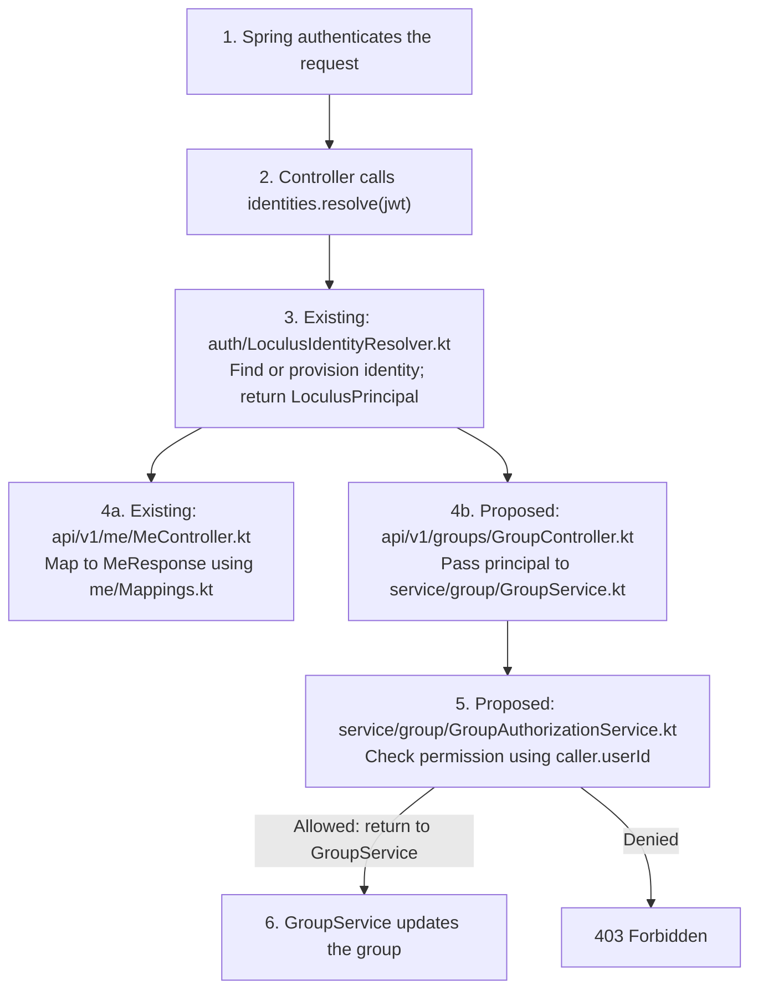

# API Package

## Folder structure

Unversioned controllers such as `info` and `debug` live at the root of the `api` package, and have their access rules defined in `config/SecurityConfig.kt`.

Otherwise, each subfolder contains one version of the API. These API version packages will themselves contain subfolders for each feature they support (`groups`, `submission`, `query`, etc.).

The structure should look like this:

```
api/
├── debug/
    └── DebugController.kt
├── info/
    └── InfoController.kt
└── vX/
    ├── VXAccessRules.kt
    └── groups/
        ├── GroupController.kt
        ├── Schemas.kt        # optional
        └── Mappings.kt       # optional
    └── submission/
        └── ...
```

Where:

- `VXAccessRules.kt`: defines endpoint access rules for the API version. This file should define a `vXAccessRules` function, which adds access rules for the API version, and this should be called in `config/SecurityConfig.kt` (which remains the 'source of truth' for access rules).
- **Controllers:** defines the endpoints (paths, status codes) and makes calls to services.
- **Schemas (optional):** request/response classes that define this version's API.
- **Mappings (optional):** bridge(s) between the schemas and the services: converting types, plus anything only this version does differently, such as ordering or reshaping results.

Schemas and mappings together let a version define its own API on top of the shared services, so services can change without changing what clients of an existing version see.

## Notes

`v0/` currently does not have its own schemas/mappings - it still pulls its input/output DTOs directly from the internal `types`. This should be refactored soon to separate the `v0` API from internal services.

Logic shared between API versions belongs in the service layer, not in controllers or mappings.
Services, tables and shared types live outside `api/` and are not versioned.

## Implementing auth for v1 endpoints

Paths below are relative to `backend/src/main/kotlin/org/loculus/backend/`.

### Existing example: GET /v1/me

When your endpoint needs a Loculus user identity, inject `auth/LoculusIdentityResolver.kt` into the controller and call `resolve(jwt)` with Spring's authenticated JWT. It returns a `LoculusPrincipal`, creating the identity on first use if needed. Use this principal in new identity-aware services rather than passing tokens or extracting usernames. `/v1/me` lets clients retrieve their own Loculus user ID and provisioning timestamp; it isn't an internal identity lookup service. Other backend endpoints should call the resolver directly, not make an HTTP request to `/v1/me`.

`/v1/me` just maps the principal to a public response. Keep your schemas and mappings alongside the controller, as in `api/v1/me/Schemas.kt` and `api/v1/me/Mappings.kt`. For an endpoint doing more work, pass the principal to your service instead. Imports and OpenAPI annotations are omitted below.

```kotlin
// api/v1/me/MeController.kt — existing implementation, abbreviated
@RestController
class MeController(private val identities: LoculusIdentityResolver) {
    @GetMapping("/v1/me")
    fun me(@AuthenticationPrincipal jwt: Jwt): ResponseEntity<MeResponse> =
        ResponseEntity.ok()
            .cacheControl(CacheControl.noStore())
            .body(identities.resolve(jwt).toResponse())
}
```

On first use, the resolver seeds a required, unique Loculus username and optional profile data through
`service/identity/provider/IdentityProviderProfileReader.kt`. The Keycloak implementation reads the
account by subject; services do not query Keycloak themselves. Existing identities keep their username
and profile unchanged. Profile synchronization and viewing/editing are deferred, and `/v1/me` still
exposes only identity metadata. Do not use names or email addresses as authorization keys.

### Proposed example: editing a group

When you add a resource operation, your service must check permission before making the change: resolving an identity doesn't grant access. You can put group policies in `service/group/GroupAuthorizationService.kt` and call them from `GroupService.kt`, so every endpoint using that operation gets the same protection. **The following is a proposed example, not implemented by this PR**: `GroupUpdate` and `memberships.canEditGroup` would need implementing, including membership lookup by Loculus user ID.

```kotlin
// api/v1/groups/GroupController.kt — proposed handler body
val caller = identities.resolve(jwt)
groups.updateGroup(caller, groupId, request.toServiceInput())

// service/group/GroupService.kt — proposed
fun updateGroup(caller: LoculusPrincipal, groupId: Int, update: GroupUpdate) {
    authorization.requireCanEditGroup(caller, groupId)
    database.updateGroup(groupId, update)
}

// service/group/GroupAuthorizationService.kt — proposed
fun requireCanEditGroup(caller: LoculusPrincipal, groupId: Int) {
    if (!memberships.canEditGroup(caller.userId, groupId)) {
        throw ForbiddenException("You cannot edit this group.")
    }
}
```


