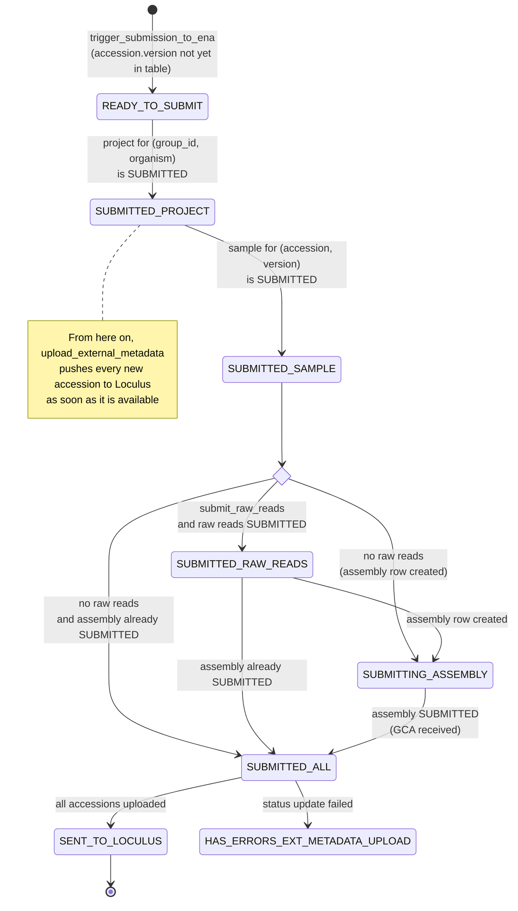
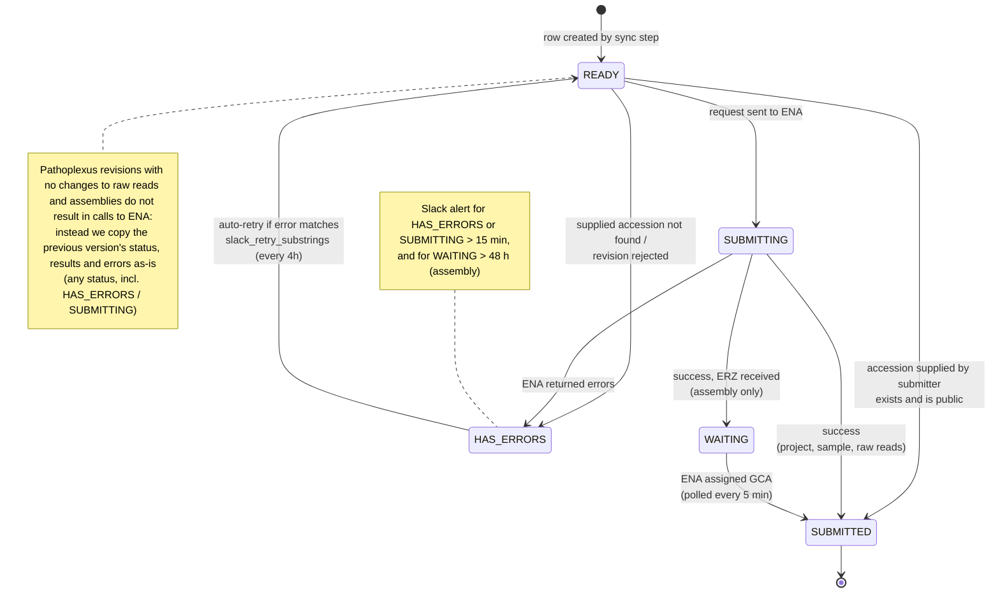

# ENA Submission

This README describes how the Loculus ENA deposition pipeline works. For background on ENA itself (its metadata model of studies, samples, assemblies and raw reads, how to submit and revise each of them, and the corresponding ENA documentation) see [ENA_submission.md](ENA_submission.md).

## Process Overview

The `loculus-get-ena-submission-list-cronjob` calls the `/get-released-data` backend-endpoint
and creates a list of all loculus sequences that can be submitted to ENA.
It then creates a Slack notification with this list,
after manual review the list can be uploaded to [github.com/pathoplexus/ena-submission](https://github.com/pathoplexus/ena-submission/).

The ena-deposition pod queries this GitHub repo for new sequences.
Upon finding a new sequence (or a new version of an already submitted sequence) the pod adds it to the `submission_table` in the `ena_deposition_schema` schema of the Loculus database.
This triggers the ENA submission process, there are four main steps to this submission:
creation of projects, samples, raw reads (only if the sequence has raw reads attached) and assemblies.
As soon as results of these steps are available (e.g. new INSDC accessions) the ena-deposition pod uploads them as external metadata to the backend using the `submit-external-metadata` backend-endpoint - i.e. a sequence will first get a bioproject accession, then a biosample accession etc.
The backend only accepts metadata in this request that is in the `externalMetadata` schema.
The backend then updates the metadata in the `sequence_entries_view` in the database with the external metadata values -
leading to the results being shown on the website.

To avoid re-ingesting the sequences submitted by the ena-deposition pod,
ingest also queries the `/submitted` endpoint of the ena-deposition pod API for the INSDC biosample
and INSDC assembly accessions of samples Loculus submitted to the INSDC.
Sequences with these accessions are filtered out of the data ingested from the INSDC.

### Status lifecycle

Each (accession, version) has an overall status in `submission_table.status_all`:



Each step (`project_table`, `sample_table`, `raw_reads_table`, `assembly_table`) has its own `status`:



For how revisions are handled, see [Revisions](#revisions).

## Cronjob

### get_ena_submission_list

This script runs twice daily (01:00 and 13:00) as a kubernetes cronjob. For each organism with an `enaOrganism` config it calls the Loculus backend (`/get-released-data`), computes a new list of sequences that are ready for submission to ENA and sends this list as a compressed json file to our slack channel. Sequences are ready for submission IFF all of the following are true:

- data in state APPROVED_FOR_RELEASE
- data must be state "OPEN" for use
- data must not already exist in ENA or be in the submission process, this means:
  - data was not submitted by the `config.ingest_pipeline_submission_group`
  - this (or a later) version is not in the `submission_table` - a later version of a sequence that is already in the `submission_table` will be added to the list (as a revision)
  - the accession version is not in the suppressed list (`config.suppressed_list_url`)
- only the highest qualifying version of each accession is added to the list

Sequences with `ena-specific-metadata` fields are uploaded in a separate file with a warning, and sequences whose latest version is a revocation are uploaded in a separate file (these might need to be suppressed in ENA).

## Threads

The ena_deposition package runs the following functions in parallel (via threads). If one thread raises an exception all other threads are stopped.

Errors are handled in the same way for the project, sample, raw reads and assembly tables: entries in state HAS_ERRORS or in state SUBMITTING for over `submitting_time_threshold_min` (15min) trigger a slack notification (at most every `slack_retry_threshold_min`). Entries whose errors contain one of the `slack_retry_substrings` are automatically reset to READY every `retry_threshold_min` (4h).

### trigger_submission_to_ena

Download the file in `approved_list_url` every `min_between_github_requests` (2min). If the accession version is not in the `submission_table` already, add it to the `submission_table` in state READY_TO_SUBMIT. This also applies to new versions of sequences that were previously submitted (see [Revisions](#revisions)).

When `ena_deposition` is run with `--input-file`, the sequences are read from that file once instead.

### create_project

In a loop:

- Get sequences in `submission_table` in state READY_TO_SUBMIT
  - if (bioprojectAccession exists in the metadata): only consider entries in the `project_table` for (group_id, organism) with this bioproject accession
  - if (there exists exactly one corresponding entry in the `project_table`):
    - if (entry is in status SUBMITTED): update `submission_table` to SUBMITTED_PROJECT (add center_name and project_id).
    - else: wait
  - else: create a project entry in `project_table` for (group_id, organism) (with the bioprojectAccession as result if it exists in the metadata) -> creates a unique `project_id`.
- Get entries in `project_table` in state READY, get the group info from Loculus
  - if (entry already has a bioproject accession): check that it exists and is public in ENA, set status to SUBMITTED, else set status to HAS_ERRORS
  - else: prepare submission object, set status to SUBMITTING
    - if (submission succeeds): set status to SUBMITTED and fill in results: the result of a successful submission is `bioproject_accession` and an ena-internal `ena_submission_accession`.
    - else: set status to HAS_ERRORS and fill in errors

#### Known limitations

Group info can be updated in loculus after the project has been created in ENA. This is not currently handled by the pipeline. Issue: <https://github.com/loculus-project/loculus/issues/2939>

### create_sample

Maps loculus metadata to ena metadata using template: https://www.ebi.ac.uk/ena/browser/view/ERC000033

In a loop

- Get sequences in `submission_table` in state SUBMITTED_PROJECT
  - if (there exists an entry in the `sample_table` for the corresponding (accession, version)):
    - if (entry is in status SUBMITTED): update `submission_table` to SUBMITTED_SAMPLE.
    - else: wait
  - else: create sample entry in `sample_table` for (accession, version) (with the biosampleAccession as result if it exists in the metadata).
- Get entries in `sample_table` in state READY
  - if (entry is a revision but not the latest version of the accession): skip
  - if (entry already has a biosample accession): check that it exists and is public in ENA, set status to SUBMITTED, else set status to HAS_ERRORS
  - else: prepare submission object, set status to SUBMITTING. The sample alias is `{accession}:{organism}:{unique_project_suffix}` (independent of the version), revisions are sent to ENA as a `MODIFY` of the existing sample.
    - if (submission succeeds): set status to SUBMITTED and fill in results, the results of a successful submission are a `biosample_accession` (starting with SAM) and an ena-internal `ena_submission_accession`.
    - else: set status to HAS_ERRORS and fill in errors

### create_raw_reads

In a loop

- Get sequences in `submission_table` in state SUBMITTED_SAMPLE and `submit_raw_reads` True (the sequence has raw read files or an insdcRawReadsAccession).
  - if (there exists an entry in the `raw_reads_table` for the corresponding (accession, version)):
    - if (entry is in status SUBMITTED): update `submission_table` to SUBMITTED_RAW_READS.
  - else: create entry in `raw_reads_table` for (accession, version) (with the insdcRawReadsAccession as result if it exists in the metadata).
- Get entries in `raw_reads_table` in state READY
  - if (entry already has a run accession): check that it exists and is public in ENA, set status to SUBMITTED, else set status to HAS_ERRORS (also if the entry has both a run accession and raw read files)
  - if (entry is a revision):
    - if (the linked biosample/bioproject accessions in the metadata differ from the last version, or manifest fields changed without the raw read files changing): set status to HAS_ERRORS, needs a manual revision
    - if (raw read files have not changed): copy the results of the last version and continue
  - prepare files: download raw read files and prepare manifest, set status to SUBMITTING
    - if (submission succeeds): set status to SUBMITTED and fill in results, the results of a successful submission are a run or `run_accession` (starting with ERR) and an experiment or `erx_accession` (starting with ERX). For revisions send a slack notification with the old run accessions that need to be suppressed in ENA.
    - else: set status to HAS_ERRORS and fill in errors

### create_assembly

In a loop:

- Get sequences in `submission_table` in state SUBMITTED_SAMPLE and `submit_raw_reads` False or in state SUBMITTED_RAW_READS and `submit_raw_reads` True
  - if (there exists an entry in the `assembly_table` for the corresponding (accession, version)):
    - if (entry is in status SUBMITTED): update `submission_table` to SUBMITTED_ALL.
    - else: update `submission_table` to SUBMITTING_ASSEMBLY.
  - else: create assembly entry in `assembly_table` for (accession, version) and update `submission_table` to SUBMITTING_ASSEMBLY.
- Get sequences in `submission_table` in state SUBMITTING_ASSEMBLY
  - if (corresponding `assembly_table` entry is in state SUBMITTED): update entries to state SUBMITTED_ALL.
- Get entries in `assembly_table` in state READY
  - if (entry is a revision):
    - if (it is not the latest version, or the linked biosample/bioproject accessions in the metadata differ from the last version): skip / set status to HAS_ERRORS. If `allow_revision_with_manifest_changes` is False, changes in the manifest fields also require a manual revision.
    - if (the sequences, the flatfile metadata - country, collection date, authors, admin levels -, the RUN_REF and the manifest fields have not changed): copy the status and results of the last version and continue
  - prepare files: we need chromosome_list, embl flatfiles and a manifest file (link to the run accession if there is a raw read associated with the consensus sequence), set status to SUBMITTING. Each submission (including revisions) gets a new, unique assembly name.
    - if (submission succeeds): set status to WAITING and fill in results: ena-internal `erz_accession` and `segment_order`
    - else: set status to HAS_ERRORS and fill in errors
- Get entries in `assembly_table` in state WAITING, every `min_between_ena_checks` (5min, to not overload ENA) check if ENA has processed the assemblies and assigned them a `gca_accession` and `insdc_accession`s. If so update the table to status SUBMITTED and fill in results
- Additionally send a slack notification for entries in state WAITING for over `waiting_threshold_hours` (48h)

### upload_external_metadata

In a loop:

- Get sequences in `submission_table` in state SUBMITTED_PROJECT, SUBMITTED_SAMPLE, SUBMITTED_RAW_READS, SUBMITTING_ASSEMBLY or SUBMITTED_ALL.
- Get the results of all the submissions that are available so far (from all other tables)
- If they differ from the external metadata previously uploaded for this sequence (stored in `submission_table.external_metadata`): create a POST request to the submit-external-metadata endpoint with the results in the expected format. Each request contains two NDJSON lines:
  - an accession-scoped line (no `version`) with the bioproject, biosample and run accessions. The backend applies these to all versions of the accession, so they are kept when the sequence is revised in Loculus (revisions are not deposited to ENA).
  - an accession-version-scoped line with the assembly accessions (GCA and INSDC accessions), which only refer to the deposited version.
- If the sequence is in state SUBMITTED_ALL and all accessions are present: set it to state SENT_TO_LOCULUS (if this update fails set it to HAS_ERRORS_EXT_METADATA_UPLOAD)
- Get sequences in `submission_table` in state HAS_ERRORS_EXT_METADATA_UPLOAD for over 15 min: send a slack notification. Unlike the other tables, these entries are never retried automatically and need to be fixed manually. The 15 min and the slack notification interval (12h) are hard-coded in `upload_handle_errors` (not read from `submitting_time_threshold_min` / `slack_retry_threshold_min`).

### check_and_update_visibility

Every `min_between_publicness_checks` (12h) query ENA and NCBI for all bioproject, biosample, run, experiment, GCA and nucleotide accessions that are not yet known to be public. When an accession becomes publicly visible, the `*_first_publicly_visible` timestamp column of the corresponding table is set.

### start_api

Runs a FastAPI server (default `127.0.0.1:5000`, configurable via `ena_deposition_host` and `ena_deposition_port`) with:

- `/health`
- `/submitted`: all biosample accessions in `sample_table` in state SUBMITTED and all INSDC nucleotide accessions in `assembly_table` in state SUBMITTED or WAITING. This is used by ingest to filter out sequences submitted by Loculus.

## Revisions

A new version of a sequence is added to the `submission_table` as its own (accession, version) entry and goes through all steps again. An entry with version > 1 is treated as a revision if another version of the same accession is in the `submission_table`. Note that the pipeline does not wait for the previous version to have finished submission before processing the revision.

- **Project**: the existing project for (group_id, organism) is reused, so the revision gets the bioproject accession immediately.
- **Sample**: the sample is resubmitted as a `MODIFY` of the existing ENA sample (same alias), this returns the same biosample accession. Note it is ok to send a modify request even if there are no biosample changes between versions. The previous version must already have been created in ENA for this to succeed.
- **Raw reads**: only resubmitted if the raw read files changed, otherwise the results of the last version are copied.
- **Assembly**: only resubmitted if the data that would be sent to ENA changed (see above), otherwise the status and results of the last version are copied. Note that ENA does not allow revisions of assemblies if the consensus sequence has not changed (this is most likely because unlike the biosample assemblies are versioned), additionally it is not possible to revise a consensus sequence back to a previous version. If the last version is still in state WAITING the revision will poll ENA for the same `erz_accession`. If `allow_revision_with_manifest_changes` is False, revision of metadata fields in the assembly manifest is not possible programmatically (an email must be sent to ENA) - the pipeline will set the assembly revision entry to the `HAS_ERRORS` state and we will receive a slack notification.

## Developing Locally

### Database

The ENA submission service creates a new schema in the Loculus Postgres DB, managed by flyway. To develop locally you will have to start the postgres DB locally e.g. by using the `../deploy.py` script or using

```sh
docker run -d \
   --name loculus_postgres \
   -e POSTGRES_DB=loculus \
   -e POSTGRES_USER=postgres \
   -e POSTGRES_PASSWORD=unsecure \
   -p 5432:5432 \
   postgres:15.19
```

### Install and run flyway

In our kubernetes pod we run flyway in a docker container, however when running locally it is best to [download the flyway CLI](https://documentation.red-gate.com/fd/command-line-184127404.html) (or `brew install flyway` on macOS).

You can then create the schema using the following command:

```sh
flyway -user=postgres -password=unsecure -url=jdbc:postgresql://127.0.0.1:5432/loculus -schemas=ena_deposition_schema -locations=filesystem:./flyway/sql migrate
```

If you want to test the docker image locally. It can be built and run using the commands:

```sh
docker build -t ena-submission-flyway .
docker run -it -e FLYWAY_URL=jdbc:postgresql://127.0.0.1:5432/loculus -e FLYWAY_USER=postgres -e FLYWAY_PASSWORD=unsecure ena-submission-flyway flyway migrate
```

### Setting up micromamba environment

<details>

<summary> Setting up micromamba </summary>

The rest of the ena-submission pod uses micromamba:

```sh
brew install micromamba
micromamba shell init --shell zsh --root-prefix=~/micromamba
source ~/.zshrc
```

</details>

Then activate the loculus-ena-submission environment

```sh
micromamba create -f environment.yml --rc-file .mambarc
micromamba activate loculus-ena-submission
```

### Pip installing the ena_deposition package

Before running the ena_deposition package you need to install it. This can be done by running:

```sh
uv pip install -e '.[test]'
```

## Testing

It's good practice to put your ENA credentials into a `.env` file in this folder (our `.gitignore` covers `.env` files).

> [!WARNING]
> When testing always submit to ENA's test/dev instance. This means for XML post requests (i.e. for project and sample creation), sending them to `https://wwwdev.ebi.ac.uk/ena` and for webin-cli requests (i.e. assembly creation) adding the `-test` flag. This is done automatically when the `submit_to_ena_prod` is set to False (which is the default). Do not change this flag locally unless you know what you are doing.
> Using our ENA test account does **not** affect which ENA instance you submit to, if you use our test account and submit to ENA production you will have officially submitted samples to ENA.

### Run tests

#### Unit tests

Tests live in `test/`. `test/test_ena_submission.py` and `test/test_get_ena_submission_list.py` can be run without a database:

```sh
micromamba run -n loculus-ena-submission pytest test/test_ena_submission.py test/test_get_ena_submission_list.py
```

The other tests (`test/test_ena_submission_integration.py`, `test/test_api.py` and `test/test_schema_matches_models.py`) need the database running locally with the `ena_deposition_schema` migrated (see the steps above).

```sh
micromamba run -n loculus-ena-submission pytest
```

#### Dry run

You can also use the `deposition_dry_run.py` script to produce the same output files/XMLs that the pipeline would produce in order to submit to ENA. This is a good test if you would like to first verify what your submission to ENA will look like. Make sure that you have the same `config.yaml` that will be used in production (use `../deploy.py` to generate this). Also note that the generator can only produce output for one submission at a time.

```sh
python scripts/deposition_dry_run.py --log-level=DEBUG --data-to-submit=results/approved_ena_submission_list.json --mode=assembly --center-name="Stellenbosch University" --bioproject="<bioproject>" --biosample="<biosample>" --config-file=config/config.yaml
```

> **_NOTE:_**
> If you want to run the ena deposition pod with the [Pathoplexus](https://github.com/pathoplexus/pathoplexus) staging or production config you can create the config locally by running or by downloading the config from argocd:
>
> ```bash
> cd ..
> python deploy.py --enableEnaSubmission config --values kubernetes/loculus/values.yaml --values {PATH_TO_LOCAL_PATHOPLEXUS_REPO}/loculus_values/values.yaml --values {PATH_TO_LOCAL_PATHOPLEXUS_REPO}/loculus_values/environment_specific_values/staging.yaml
> ```


#### Integration tests

You can also run the integration tests locally, these will submit sequences to ENA dev. Be careful when modifying these tests to always set `test=true`.

You also need to set the environment variables `ENA_USERNAME` and `ENA_PASSWORD` to your ENA test account credentials. You can use the `.env` file in the root of this repository to set these variables.

Depending on the type of ENA account you are using, you need to set `is_broker` to `True` or `False`. By default it's `False`.

```sh
docker run --name test-postgres -e POSTGRES_USER=postgres -e POSTGRES_PASSWORD=unsecure -e POSTGRES_DB=loculus -p 5432:5432 -d postgres
flyway -url=jdbc:postgresql://localhost:5432/loculus -schemas=ena_deposition_schema -user=postgres -password=unsecure -locations=filesystem:./flyway/sql migrate
micromamba run -n loculus-ena-submission pytest test/test_ena_submission_integration.py
```

The tests perform the same tests as described in the section on testing submission locally below.

### Testing submission locally

1. Run loculus locally (need prepro, backend and ena-submission pod), e.g.

```sh
../deploy.py cluster --dev
../deploy.py helm --dev --enablePreprocessing
../generate_local_test_config.sh
cd ../backend
./start_dev.sh &
cd ../ena-submission
micromamba activate loculus-ena-submission
uv pip install -e '.[test]'
flyway -user=postgres -password=unsecure -url=jdbc:postgresql://127.0.0.1:5432/loculus -schemas=ena_deposition_schema -locations=filesystem:./flyway/sql migrate
```

2. Submit data to the backend as test user (create group, submit and approve - create 2 groups if insdc_ingest_group has not be created), e.g. using [example data](https://github.com/pathoplexus/example_data). (To test the full submission cycle with insdc accessions submit cchf example data with only 2 segments.)

```sh
KEYCLOAK_TOKEN_URL="http://localhost:8083/realms/loculus/protocol/openid-connect/token"
KEYCLOAK_CLIENT_ID="backend-client"
usernameAndPassword="testuser"
jwt_keycloak=$(curl -X POST "$KEYCLOAK_TOKEN_URL" --fail-with-body -H 'Content-Type: application/x-www-form-urlencoded' -d "username=$usernameAndPassword&password=$usernameAndPassword&grant_type=password&client_id=$KEYCLOAK_CLIENT_ID")
JWT=$(echo "$jwt_keycloak" | jq -r '.access_token')
curl -X 'POST' 'http://localhost:8079/groups' \
  -H 'accept: application/json' \
  -H "Authorization: Bearer ${JWT}" \
  -H 'Content-Type: application/json' \
  -d '{
  "groupName": "ENA submission Group",
  "institution": "University of Loculus",
  "address": {
    "line1": "1234 Loculus Street",
    "line2": "Apt 1",
    "city": "Dortmund",
    "state": "NRW",
    "postalCode": "12345",
    "country": "Germany"
  },
  "contactEmail": "something@loculus.org"}'
LOCULUS_ACCESSION=$(curl -X 'POST' \
  'http://localhost:8079/cchf/submit?groupId=2&dataUseTermsType=OPEN' \
  -H 'accept: application/json' \
  -H "Authorization: Bearer ${JWT}" \
  -H 'Content-Type: multipart/form-data' \
  -F 'metadataFile=@../../example_data/example_files/cchfv_test_metadata.tsv;type=text/tab-separated-values' \
  -F 'sequenceFile=@../../example_data/example_files/cchfv_test_sequences.fasta' | jq -r '.[0].accession')
curl -X 'POST' 'http://localhost:8079/cchf/approve-processed-data' \
  -H 'accept: application/json' \
  -H "Authorization: Bearer ${JWT}" \
  -H 'Content-Type: application/json' \
  -d '{"scope": "ALL"}'
```

3. Get list of sequences ready to submit to ENA, locally this will write `results/{organism}_ena_submission_list.json` (one file per organism), you need to copy the config produced by `../generate_local_test_config.sh`.

```sh
cp ../website/tests/config/ena-submission-config.yaml config/config.yaml
mkdir -p results
python scripts/get_ena_submission_list.py --config-file=config/config.yaml --output-dir=results
```

4. Check contents and then rename to `results/approved_ena_submission_list.json`, trigger ena submission by adding entries to the submission table and using the `--input-file` flag

```sh
cp results/cchf_ena_submission_list.json results/approved_ena_submission_list.json
ena_deposition --config-file=config/config.yaml --input-file=results/approved_ena_submission_list.json
```

Alternatively you can upload data to the [test folder](https://github.com/pathoplexus/ena-submission/blob/main/test/approved_ena_submission_list.json) and run:

```sh
ena_deposition --config-file=config/config.yaml
```

Note that if you use data that you have not uploaded to Loculus the final step (uploading the results of ENA submission to Loculus) will fail as the accession will be unknown.

5. Note that ENA's dev server does not always finish processing and you might not receive a `gcaAccession` for your dev submissions. If you would like to test the full submission cycle on the ENA dev instance it makes sense to manually set the `erz_accession` of the (WAITING) assembly in the database to `ERZ24784470` (a known test submission with 2 chromosomes/segments - sadly ERZ accessions are private so I do not have other test examples). You can do this after connecting via pgAdmin or connecting via the CLI:

```sh
psql -h 127.0.0.1 -p 5432 -U postgres -d loculus
```

Then perform the update:

```sql
SET search_path TO ena_deposition_schema;
UPDATE assembly_table
SET result = '{"erz_accession": "ERZ24784470", "segment_order": ["L", "M"]}'::jsonb
WHERE accession = '$LOCULUS_ACCESSION';
```

Exit `psql` using `\q`.

If you experience issues you can look at the database locally using pgAdmin. On local instances the password is `unsecure`.

### Testing submission on a preview instance

1. Upload data to the [test folder](https://github.com/pathoplexus/ena-submission/blob/main/test/approved_ena_submission_list.json) - note that if you add fake data with a non-existent group-id the project creation will fail, additionally the `upload_external_metadata` thread will fail if these sequences do not actually exist in your loculus instance.

2. Connect to the database of the preview instance via port forwarding using a database tool such as pgAdmin:

- Apply the preview `~/.kube/config`
- Find the database POD using `kubectl get pods -A | grep database`
- Connect via port-forwarding `kubectl port-forward $POD -n $NAMESPACE 5432:5432`
- If necessary find password using `kubectl get secret`

### Example submission data

You can use the dry-run script to generate submission files from released loculus data. You can also use the examples in https://github.com/anna-parker/ena-testing-example-data to submit test data. 
